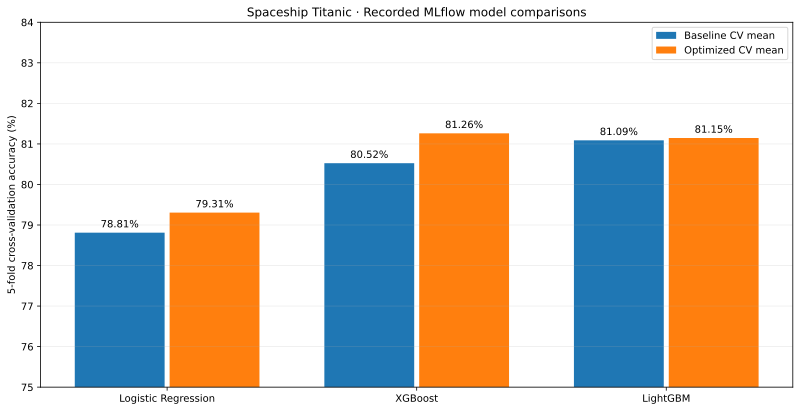

# Spaceship Titanic — Classification, MLflow and Deployment Evidence

**Python · Scikit-learn · XGBoost · LightGBM · Optuna · MLflow · Streamlit · AWS SageMaker · AWS EC2**

This is an **existing repository** that already contains a local Logistic Regression + Streamlit deployment implementation. This documentation update preserves the existing `.py` source files and trained model artifacts, and **adds** a separate multi-model Kaggle experiment notebook, reproducibility notes, EDA plots and historical deployment screenshots.

## Two related tracks (do not confuse their results)

| Track | Scope | Verified evidence |
| --- | --- | --- |
| Kaggle classifier | Three model families, EDA, feature engineering, Optuna + 5-fold CV | Kaggle public submission **0.79401** in screenshot; notebook MLflow XGBoost CV mean **0.81261** |
| Local / cloud MLOps demonstrations | Experiment tracking, MLflow registry, Streamlit, SageMaker and EC2 | Original screenshots of local prediction, SageMaker Endpoint **InService** in May 2026, and EC2 Streamlit ↔ SageMaker successful prediction |

**Metric caveat:** The Kaggle public score, the model CV metrics in the notebook, and the separate SageMaker Logistic Regression tuning score are **not** results of the same evaluation. The notebook registers XGBoost as MLflow `@champion`, but its submission creation code calls `lr_final.predict(X_test)` (Logistic Regression). The provided Kaggle screenshot does not prove exactly which notebook revision produced the submission.

## Verified notebook facts

| Item | Recorded value |
| --- | --- |
| Kaggle training rows | 8,693 |
| Training source columns | 14 (including target) |
| Binary target composition | 4,378 True / 4,315 False |
| Model features after feature engineering | 27 |
| Baseline hold-out accuracy: LightGBM | 0.81081 |
| Baseline hold-out accuracy: XGBoost | 0.79931 |
| Baseline hold-out accuracy: Logistic Regression | 0.76998 |
| Optimized 5-fold CV: XGBoost | 0.81261 |
| Optimized 5-fold CV: LightGBM | 0.81146 |
| Optimized 5-fold CV: Logistic Regression | 0.79305 |
| Historical Kaggle public score | 0.79401 |

## Contents

- Original repository Python files: local classification pipeline, Streamlit app and saved model assets (retained, not overwritten by this update).
- `notebooks/spaceship_titanic_experiments.ipynb`: original saved EDA, three-model experiments, Optuna, MLflow and competition submission generation.
- `docs/EXPERIMENTS.md`: method and recorded metrics, including source/metric boundaries.
- `docs/DEPLOYMENT_EVIDENCE.md`: evidence inventory for local Streamlit, SageMaker and EC2 demonstrations.
- `docs/REPRODUCIBILITY.md`: requirements, known limitations and safe workflow suggestions.
- `docs/screenshots/`: resized/cropped original evidence images (AWS identifiers redacted).
- `docs/figures/`: three genuine saved notebook EDA plots and a documented CV comparison chart.

## Source-code scope

The source files at the root of the existing repository are a **local Logistic Regression Streamlit variant**. The multi-model notebook is a **separate experiment track**. Screenshots are evidence of historical AWS deployment; they are **not substitutes** for the full cloud provisioning source, which was not included in the user-supplied files for this documentation update.

## Running

Install dependencies from the existing repository's `requirements.txt` to use its local application. The notebook requires `train.csv` and `test.csv` from [the public Kaggle competition](https://www.kaggle.com/competitions/spaceship-titanic/data), plus packages described in `docs/REPRODUCIBILITY.md`.

Cloud AWS screenshots document an endpoint/service running at the time recorded; no claim is made that an EC2 instance or SageMaker endpoint remains online now.

## Credits

Academic project documented by **Hazel Novero Winata**. Kaggle competition data are supplied by Kaggle.
